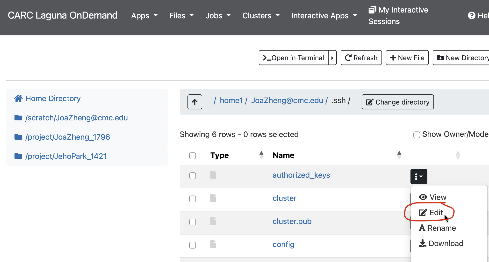

# Runbook: ComfyUI on Laguna + port forwarding


## 0. SSH setup            

**1. Create a key on your machine (once):**                                  
```
    mkdir -p ~/.ssh && chmod 700 ~/.ssh                                      
    ssh-keygen -t ed25519 -f ~/.ssh/id_ed25519_laguna -C "your.name@cgu.edu" 
    chmod 600 ~/.ssh/id_ed25519_laguna ~/.ssh/id_ed25519_laguna.pub
```

**2. Copy the PUBLIC key** (never the private one — the file without         
`.pub`):

```
cat ~/.ssh/id_ed25519_laguna.pub
```

Copy the the whole line, starting with `ssh-ed25519`.

**3. Add it in the CARC web portal:**                                        

1. Sign in to the CARC user portal in your browser: **[https://laguna-ood.carc.usc.edu](https://laguna-ood.carc.usc.edu)**
2. Go to **Files → Home Directory**.
3. Open **.ssh** folder.
4. Edit `authorized_keys` file.

5. Paste your public key and hit Save.

**4. Point your client at the key** — add this to your computer's `~/.ssh/config`:                                                
```
 Host laguna
     HostName laguna1.carc.usc.edu
     User <username>@cgu.edu 
     IdentityFile ~/.ssh/id_ed25519_laguna
     IdentitiesOnly yes
     ServerAliveInterval 60
     StrictHostKeyChecking accept-new
```                     
**5. Test it**
```
ssh laguna 'hostname; whoami; cat /project/JoaZheng_1796/drucker/comfy.sbatch'         
```


                                                                
**Troubleshooting**: `Permission denied (publickey)` usually means the key hasn't propagated yet, or the wrong file was pasted (it must be the `.pub`), or project membership is missing. Try re-adding the public key in the web portal. 

The "post-quantum key
exchange" warning is harmless.
 
---

## 1. ComfyUI Requirements

| You need | Details |
|---|---|
| Laguna access | A USC CARC account that's a member of project `JoaZheng_1796` |
| SSH key | Your own key registered with CARC (an example below uses `~/.ssh/id_ed25519_laguna`) |

---


## 2. Start ComfyUI on Laguna

```bash
ssh laguna
sbatch /project/JoaZheng_1796/drucker/comfy.sbatch
squeue -u $USER -o "%.10i %.2t %.10M %.12R"
cat /project/JoaZheng_1796/drucker/logs/comfy_node.txt   # e.g. c22-11.carc.usc.edu
```


The batch script starts ComfyUI on **port 8188**, listening only on the compute node, and writes the
node it landed on to `logs/comfy_node.txt`. 

---

## 3. Port-forward ComfyUI to your machine

Exit the connection to your Laguna instance. When you've reconnected to your local machine, we'll open a port from your machine to our ComfyUI service on Laguna.

```bash
exit
ssh -N -L 8199:<NODE>:8188 laguna
```

- Replace `<NODE>` with the **short** name from `comfy_node.txt` (e.g. `c22-11`, without`.carc.usc.edu`). The target must be the **compute node** — the login node does not run ComfyUI.
- `-N` = forward only, no shell. Add `-f` to run it in the background.
- Keep the terminal open to maintain the connection.

You won't receive a confirmation message when the port is successfully open. You can check the status by visiting ComfyUI itself.


Open **http://localhost:8199** to visit ComfyUI. (plain `http`, not `https`). First start takes ~30–60 s.


### Notes
**The tunnel dies with the job.** The 8-hour wall limit ends ComfyUI; resubmit (section 2),
**re-read `comfy_node.txt`** — the node often changes — and reopen the tunnel with the new name.